<!-- markdownlint-disable MD033 MD041 -->
<div align="center">


# Lore Platform

<a href="https://arutar.github.io/lore/"><b>LIVE PREVIEW&nbsp;→</b></a>

**A self-hosted version control server for teams with large binary files —<br>
as simple as SVN, built on [Epic Games' Lore](https://github.com/EpicGames/lore).**

Web interface · Active Directory sign-in · Windows Explorer integration · enforced file locks · one-command Docker deployment

[](../../releases)
[](https://github.com/arutar/lore/actions/workflows/platform-server.yml)
[](LICENSE)

<a href="https://arutar.github.io/lore/"></a>

[Live preview](https://arutar.github.io/lore/) · [Install](platform/docs/install.md) · [Docker reference](platform/docs/docker.md) · [Download](../../releases) · [How it works](#how-it-works) · [Differences from Lore](#how-this-differs-from-upstream-lore) · [Status](#status)

<a href="https://arutar.github.io/lore/">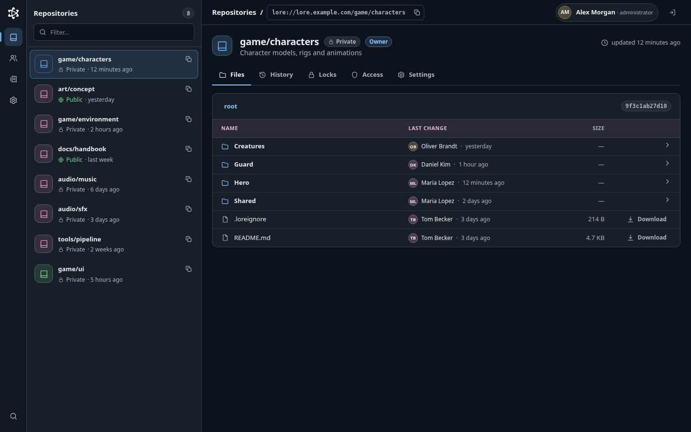</a>

<sub>The live preview is the real web interface running in your browser on a fictional studio's data: browse repositories, files, history, locks, access, users and the audit log, and switch between the nine themes. It's read-only — nothing you do is saved.</sub>

</div>

## Why this project exists

Game studios, CAD and media teams version **large binary files**: textures, models, scenes,
audio, video. Git struggles with them, SVN is showing its age, and commercial systems cost a lot
per seat. Epic Games' **Lore** is a modern engine built exactly for this — large files, file
locking, partial and virtual working copies — but Lore is an *engine*. A team needs more around
it: a web interface, user and permission management, sign-in with their corporate accounts, a
Windows client people actually use, and a server an administrator can set up in an afternoon.

That full product will come from upstream eventually. But **in a time when AI tooling moves
in weeks, waiting a year or two for a finished system is a luxury we can't afford.** We need a
system we can put to work *now*. This project assembles the missing pieces around Lore so a team
can start using it today, keeps the changes to Lore itself small, and offers them upstream so
the fork can shrink as Lore matures.

## What you get

- **Web interface** — browse files with who changed each one last and when, history and locks;
  download any file at any revision; manage repositories, access, users, audit log and settings.
  Russian and English, nine themes, works on a phone.
- **File locks that hold** — lock a binary file before editing it, and the server refuses anyone
  else's push that changes it. Locks survive restarts and are in backups. A repository owner can
  release a lock left behind by someone who is away or has left; it goes to the audit log.
- **Simple permissions** — *Read*, *Write*, *Owner* per repository, for users, Active Directory
  groups (nested groups included), all signed-in users or everyone (public). Private
  repositories are invisible to people without access.
- **Active Directory** — users sign in with their Windows login. Removing someone from a group or
  disabling the account takes effect within minutes, also for desktop clients. Local email
  accounts for external partners, optional self-registration.
- **Windows client** — MSI with the `lore` CLI, Explorer context menu (Clone, Sync, Commit,
  Stage, Unstage, Revert, Resolve conflicts, Status, History, Lock, Unlock) and status icons.
  It never decides for you where work could be lost: when someone changed the same file, or
  files are staged, it lists the files and asks how to go on; discarding your changes is always
  confirmed first. Sign in once in the browser; the session is kept.
- **Linux CLI** built from this fork.
- **Easy server** — Docker Compose bundle: `setup` generates the secrets, starts everything,
  connects AD and mail, and prints the admin password. Backup and restore scripts included.
- **Internal and external networks** — plain HTTP inside the office with nothing to configure on
  the clients, or HTTPS with automatic Let's Encrypt certificates, or behind your own reverse
  proxy. Works without internet access.

## Screenshots

| | |
|---|---|
| 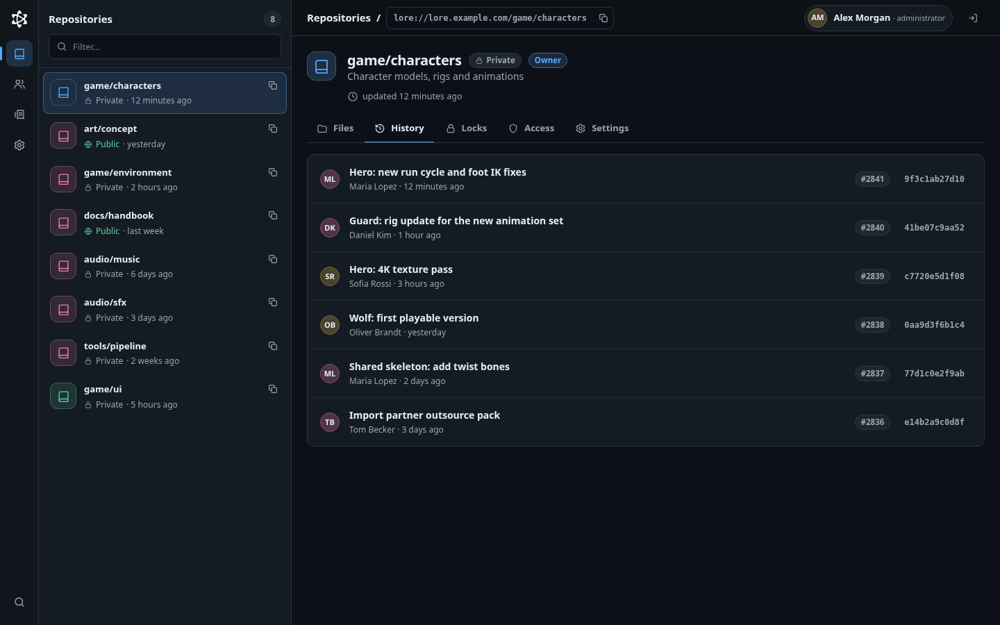<br>**History** — every revision with its author | 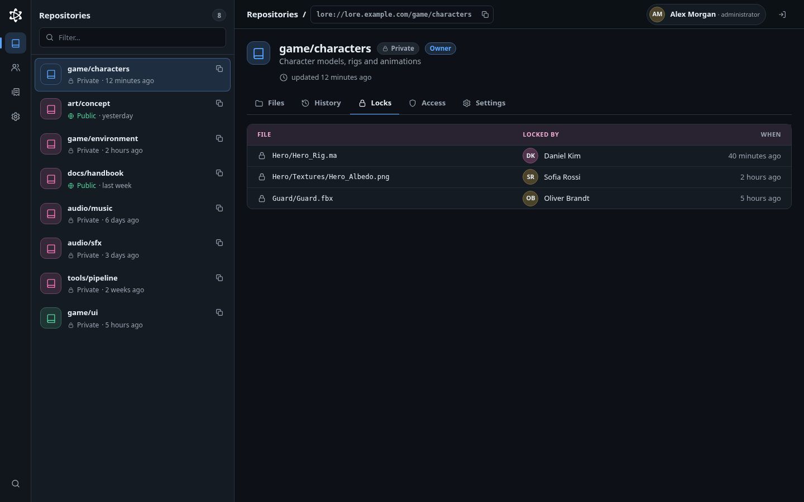<br>**Locks** — who is editing which binary file; owners can release a lock someone left behind |
| 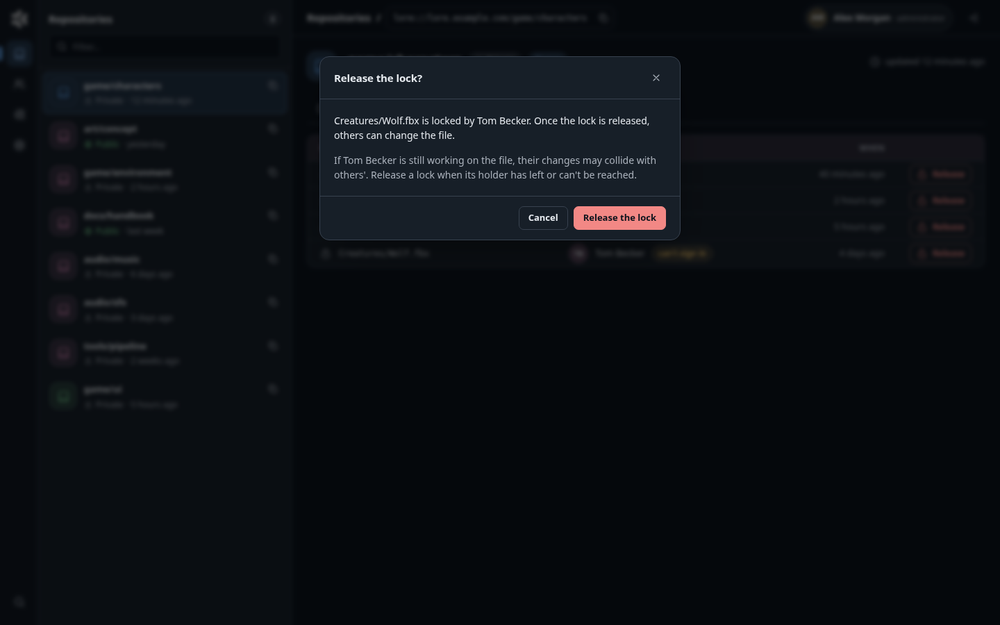<br>**Release a lock** — confirmed, and recorded in the audit log | 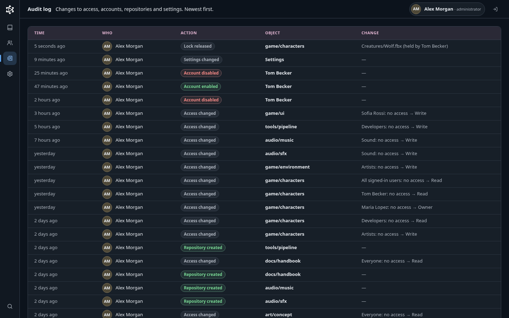<br>**Audit log** — who changed what |
| 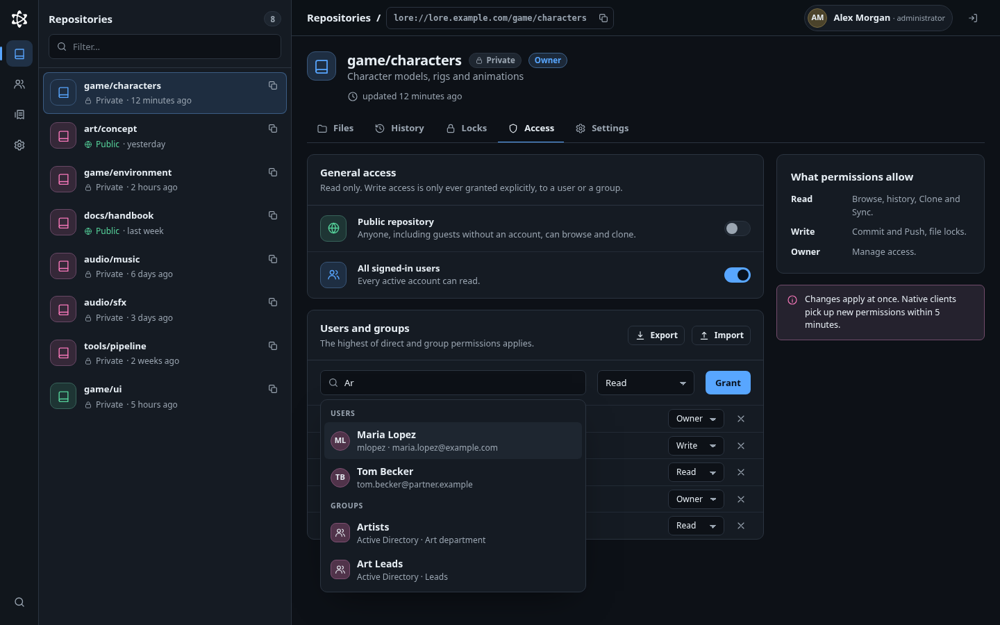<br>**Access** — grant to users and AD groups as you type | 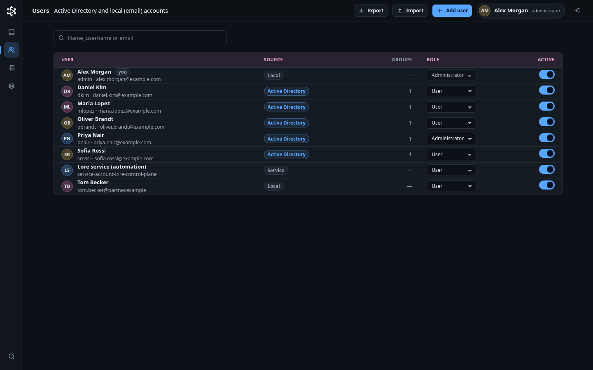<br>**Users** — Active Directory and local accounts |
| 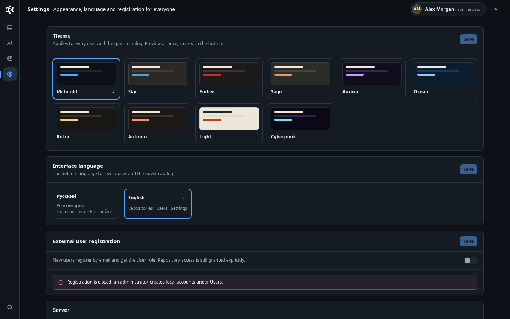<br>**Settings** — theme, language, registration | 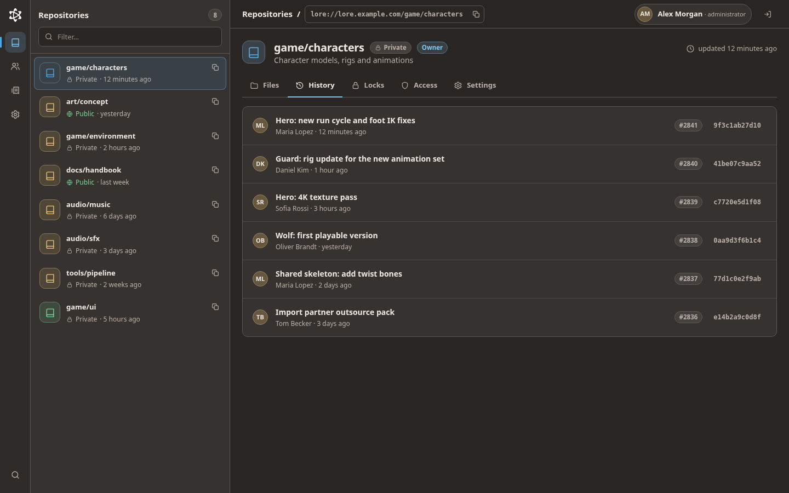<br>**Themes** — nine built-in themes |
| 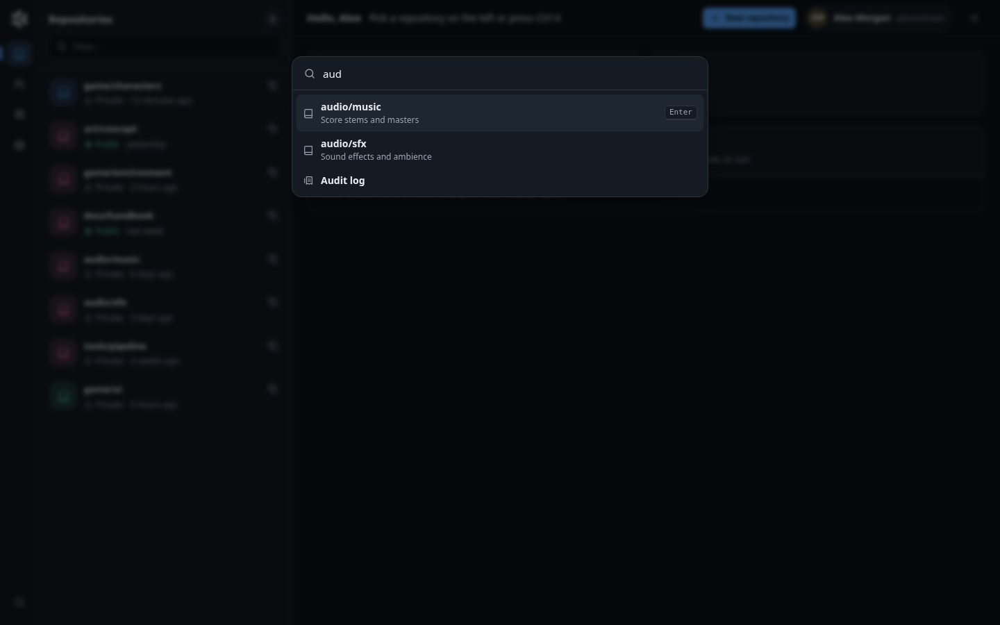<br>**Ctrl K** — jump to any repository or page | |

### Windows client

| | |
|---|---|
| 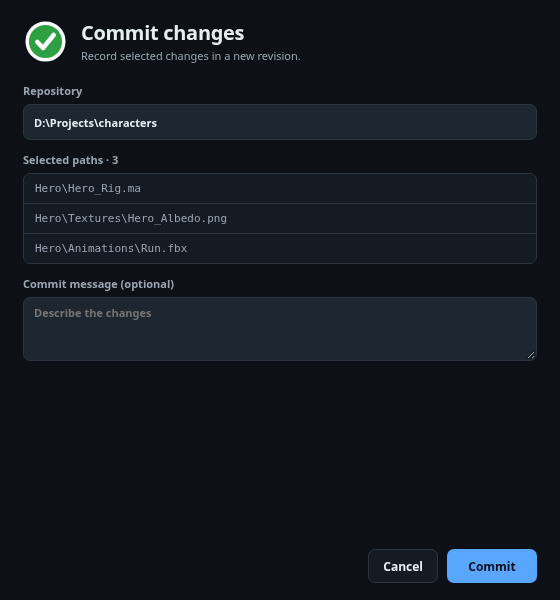<br>**Lore Commit...** from the Explorer menu | 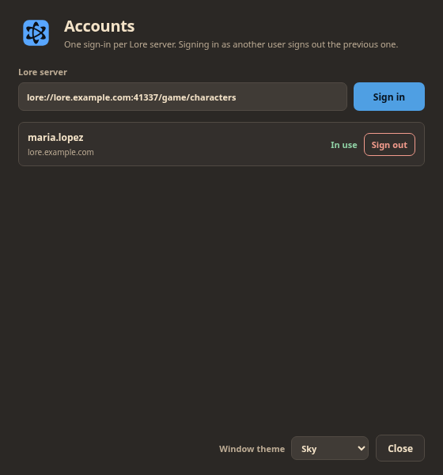<br>**Accounts** — one sign-in per server, window theme |
| 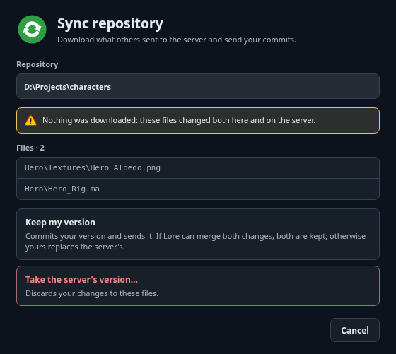<br>**Sync asks first** — the same files changed here and on the server: keep yours or take the server's | 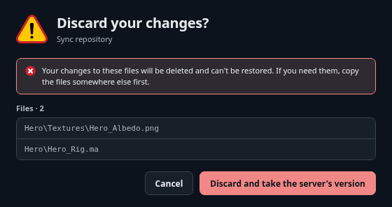<br>**Nothing is lost silently** — discarding your changes is confirmed, file by file |

The Explorer context menu and status icons follow the Windows light or dark mode. The Lore
windows (Clone, Commit, Accounts...) use the same nine themes as the WebUI: pick one under
**Window theme** in Explorer → **Lore** → **Accounts**.

When Lore can't go on without a decision, the window stops before touching those files and
offers the ways forward; **Cancel** always leaves everything as it was:

| Situation | Choices |
|---|---|
| Sync while files are staged for commit | **Commit and sync** · **Sync without committing** (the changes stay in the files) |
| A file changed both here and on the server, on Sync or Commit | **Keep my version** (merged when Lore can, otherwise yours wins) · **Take the server's version** (confirmed) |
| Revert changes | confirmed; files the server never had are left in place |

<sub>Screenshots show the real interface with demo data.</sub>

## How it works

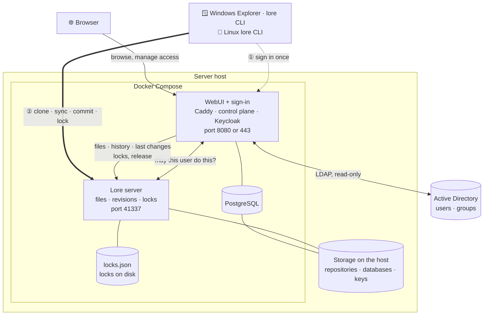

**For the administrator:** one host with Docker runs five containers. All data — repository
contents, file locks, the two databases and the signing key — lives in one directory on the host,
which `backup.sh` archives. Users and groups come from Active Directory (read-only); access is managed in
the WebUI.

**For a user:**

1. Open the WebUI, sign in with your Windows account, find the repository and copy its address
   (`lore://server/team/project`).
2. In Explorer: right-click → **Lore Clone...**, paste the address. The first time, a browser
   window asks you to sign in; after that the client remembers you.
3. Work as usual: **Lore Sync** to get changes, **Acquire locks** before editing a binary file,
   **Lore Commit...** to send your work. Files (with who changed them last), history and locks
   are visible in the WebUI.

Under the hood: after sign-in the client asks the control plane for a short-lived token for one
repository; the control plane checks the permissions (including current AD groups) and the Lore
server accepts only that token. Permissions are therefore enforced in one place for the WebUI and
the desktop clients. Locks are enforced by the Lore server itself: a push that changes a file
someone else holds a lock on is refused, whichever client sent it.

**When someone leaves:** removing a person from Active Directory (or disabling the account) takes
away their access at the next check; their commits and history stay as they are. Locks they still
hold are marked *can't sign in* on the Locks tab, where a repository owner can release them.

## Quick start

You need a host with Docker (Docker Engine with Compose v2 on Linux, Docker Desktop on Windows),
2 CPU cores and 4 GB of RAM. Download the server bundle from [Releases](../../releases).

<details open>
<summary><b>Linux</b></summary>

```sh
# 1. Unpack the bundle
tar -xzf lore-platform-server-0.2.1.tar.gz && cd lore-platform-server-0.2.1

# 2. Run setup with the name your users will type; keep the data outside the bundle
LORE_DATA_ROOT=/srv/lore-data LORE_PUBLIC_HOST=lore.corp.local sh setup.sh

# 3. Open http://lore.corp.local:8080 and sign in as "admin"
#    with the password setup printed (also stored in .env)
```

Run it as a user in the `docker` group (or as root). Port 8080 taken? Add `LORE_HTTP_PORT=18080`.
Behind a proxy or without internet access: see
[the Docker reference](platform/docs/docker.md#behind-a-proxy-or-without-internet-access).

</details>

<details>
<summary><b>Windows</b></summary>

In PowerShell, as the user that runs Docker Desktop:

```powershell
# 1. Unpack the bundle
Expand-Archive lore-platform-server-0.2.1.zip -DestinationPath C:\lore
cd C:\lore\lore-platform-server-0.2.1

# 2. Run setup with the name your users will type; keep the data outside the bundle
$env:LORE_DATA_ROOT = "D:\lore-data"
.\setup.ps1 -PublicHost lore.corp.local

# 3. Open http://lore.corp.local:8080 and sign in as "admin"
#    with the password setup printed (also stored in .env)
```

Port 8080 taken? Add `-HttpPort 18080`. If PowerShell refuses to run the script, allow it for
this window first: `Set-ExecutionPolicy -Scope Process Bypass`.

</details>

Add Active Directory by passing `LORE_LDAP_URL`, `LORE_LDAP_BASE_DN`, `LORE_LDAP_BIND_DN` and
`LORE_LDAP_BIND_PASSWORD` to the same command (on Windows as `$env:` variables before
`setup.ps1`).

- **[Running the server with Docker](platform/docs/docker.md)** — every script and its arguments,
  every variable, ports, the data directory, backup and restore.
- **[Installation guide](platform/docs/install.md)** — step by step: choosing the name, Active
  Directory, HTTPS, mail, clients, upgrades, troubleshooting.

Clients: `LoreClient-<version>-x64.msi` for Windows, `lore-cli-<version>-<arch>.tar.gz` for Linux,
both on the [Releases](../../releases) page.

## How this differs from upstream Lore

| | [Upstream Lore](https://github.com/EpicGames/lore) | This project |
|---|---|---|
| Version control engine | ✔ | Same engine, tracked from upstream |
| Web interface | — | Files, history, locks, downloads, administration |
| Users and permissions | Token-based authorization (OIDC / JWT), no management UI | Read / Write / Owner for users, AD groups, all signed-in users, public |
| Active Directory | — | Sign-in, nested groups, account status followed within minutes |
| Local accounts, registration, password reset | — | Through Keycloak |
| Windows Explorer integration | — | Context menu, status icons, MSI installer; asks before anything that could lose work |
| Server deployment | Server binary / container, you assemble the rest | Docker Compose bundle with setup, backup and restore |
| Plain HTTP inside an internal network | Sign-in requires HTTPS (except localhost) | Allowed to the same host as the Lore server, no client configuration |
| Anonymous clone of public repositories | — | Supported |
| File locks | Advisory: nothing stops a push that changes a locked file; the bundled store keeps them in memory only | Enforced: the server refuses a push that changes a file someone else has locked; locks are kept on disk, survive restarts and are in backups; owners release locks left behind from the WebUI |

**Why a fork and not a plugin.** Almost everything lives in [`platform/`](platform) and talks to
Lore through its public gRPC services. A few things can only be done inside Lore itself — about
300 changed lines in some fifteen files of `lore-server`, `lore-transport` and `lore-revision`:

- the server accepts repository-scoped tokens issued by the control plane, with the key endpoint
  reachable inside Docker;
- clients fall back to an anonymous token for public repositories;
- clients allow plain-HTTP sign-in when the sign-in server is the same host as the Lore server
  they connect to (internal networks without certificates).
- a lock store kept in a file and a push hook that enforces locks — both added through Lore's own
  plugin and hook extension points (`lore-server/src/plugins/file_locks.rs`,
  `lore-server/src/hooks/lock_guard.rs`), so upstream code is barely touched.

After merging upstream changes, run the checks in
[platform/windows/tests](platform/windows/tests/README.md#after-merging-upstream-lore).

These changes are offered upstream ([EpicGames/lore#278](https://github.com/EpicGames/lore/issues/278)).
The rest of the tree is upstream Lore, merged as it evolves; its original README is
[README.upstream.md](README.upstream.md).

## Status

Version 0.1.x — in use on an internal test installation with a live Active Directory.

Verified: clean install and re-install, AD sign-in with nested groups, group removal and account
disabling reaching desktop clients, AD outage handling, clone / commit / push from Windows,
backup and restore, the WebUI. An end-to-end test (setup → sign-in → permissions → backup →
restore) passes on that installation and is wired into CI.

The Windows client has its own checks against a live installation
([platform/windows/tests](platform/windows/tests/README.md)): 22 Companion scenarios with a second
person working on the same repository at the same time (conflicts, locks, staged files, Revert,
a server restart), and 21 steps through the real Explorer menu with the status icons checked
after each. All pass on the test installation.

Not yet verified: public DNS with Let's Encrypt on an internet-facing host; signed release
binaries. See [platform/docs/current-status.md](platform/docs/current-status.md) (Russian) for
details.

## Performance

The WebUI stays responsive with tens of thousands of repositories and Active Directory accounts:
searches use trigram indexes, AD group checks a GIN index, paging walks the primary key, and every
query is planned for its actual values so the indexes are always used.

Measured through the control plane's storage layer (the same code and connection pool the server
uses), PostgreSQL 18, default configuration, on a modest 8-core Xeon E5-2630 (2012) server.
Data: **50,000 repositories, 50,000 users, 151,000 permissions, 1,000 AD groups** (126 MB database).

| Operation | median | p95 |
|---|---|---|
| Repository list, administrator, any page | 1.7 ms | 2.1 ms |
| Repository search by name | 6.9 ms | 7.4 ms |
| Repository list of a user (direct + AD group permissions) | 6.5 ms | 7.9 ms |
| Repository search of a user | 4.1 ms | 5.1 ms |
| User search (Users page, "grant access" suggestions) | 3.3 ms | 4.3 ms |
| Does an AD group have members | 0.3 ms | 0.4 ms |
| Permissions of a repository (Access tab) | 0.2 ms | 0.3 ms |
| Audit log page | 0.2 ms | 0.2 ms |
| Session check (every request) | 0.2 ms | 0.2 ms |

Expired sign-in sessions are removed as new ones are created, so the session table stays small.

## Repository layout

| Path | What |
|---|---|
| [`platform/deploy`](platform/deploy) | Docker Compose, setup, backup, restore, end-to-end test |
| [`platform/control-plane`](platform/control-plane) | Go: WebUI API, permissions, AD, token exchange |
| [`platform/web`](platform/web) | React + TypeScript WebUI |
| [`platform/windows`](platform/windows) | Explorer extension (C++), Companion windows (C#/WebView2), MSI (WiX) |
| [`platform/windows/tests`](platform/windows/tests) | Client checks against a live installation: Companion scenarios, Explorer menu |
| [`platform/docs`](platform/docs) | Installation guide, Docker reference, architecture, status |
| everything else | Upstream Lore (Rust) with the small changes listed above |

## Building and testing

```sh
cd platform/control-plane && go test ./...       # with TEST_DATABASE_URL also against PostgreSQL
cd platform/web && npm ci && npm run build
cargo build --release -p lore-client --bin lore  # the CLI
pwsh platform/windows/Build-Client.ps1           # Windows client; Build-Msi.ps1 for the installer
cargo test -p lore-server --test unit lock       # the lock store
pwsh platform/windows/tests/Run-ClientTests.ps1 -Web http://lore.corp.local:8080 -EnvFile .env -Explorer
```

Releases are built by GitHub Actions when a `platform-vX.Y.Z` tag is pushed: Windows MSI and ZIP,
Linux CLI (x86-64 and ARM64), the server bundle, checksums, and the container images on GHCR.

## Authors

- **Arsen Arutyunyan** (arutar, [GitHub](https://github.com/arutar))
- **Vlad Tagintsev** (Fiend3d, [GitHub](https://github.com/Fiend3d))

Built on [Lore](https://github.com/EpicGames/lore) by Epic Games and its contributors.

## License

MIT, like upstream Lore — see [LICENSE](LICENSE).
