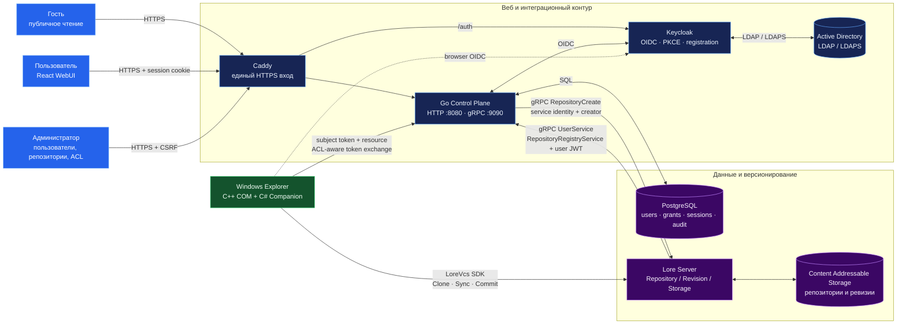
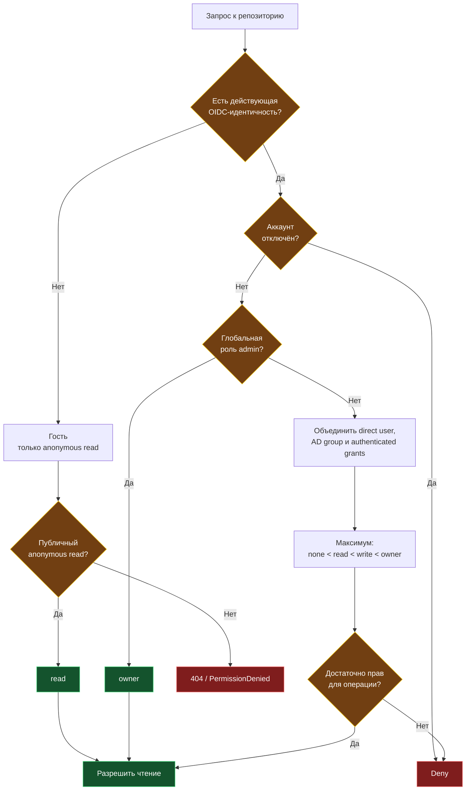

# Архитектура Lore Platform

## Система в целом



## Создание настоящего репозитория

```mermaid
sequenceDiagram
    autonumber
    actor A as Владелец
    participant W as React WebUI
    participant C as Control Plane
    participant P as PostgreSQL
    participant L as Lore Server

    A->>W: Имя, описание, видимость
    W->>C: POST /admin/repositories + CSRF
    C->>C: Проверка admin и имени
    C->>C: Сохранить client-supplied UUID для идемпотентного retry
    C->>L: RepositoryCreate(id, default_branch_id, creator)
    alt Lore подтвердил создание
        L-->>C: Repository
        C->>P: Зафиксировать репозиторий, owner grant и public read
        C-->>W: 201 Created
        W-->>A: Репозиторий доступен
    else Сбой Lore или конфликт
        L-->>C: AlreadyExists / Unavailable / ошибка
        C-->>W: Понятная ошибка без ложного успеха
        Note over C,P: Повтор использует тот же ID;<br/>незавершённую операцию обрабатывает reconciliation
    end
```

## Вычисление доступа



## Границы доверия

- Bearer-токены не передаются через Windows request files и не записываются в overlay cache.
- WebUI использует opaque session cookie и CSRF для изменяющих запросов.
- gRPC `:9090` предназначен для внутренней сети; публичный вход — HTTPS через reverse proxy.
- Гость не получает write- или owner-grant; `none` не является deny-правилом.
- Anonymous Clone использует `urn:lore:grant-type:anonymous`: control plane разрешает имя или ID только при anonymous Read и подписывает краткоживущий read-only JWT. Имена приватных репозиториев не раскрываются.
- Native logout проверяет подпись и subject JWT; истёкший токен принимается только для завершения сессии и не даёт доступа к данным.
- AD provisioning ищет пользователя в LDAP по `sAMAccountName`, при необходимости сопоставляет по email с federated Keycloak-аккаунтом и загружает группы до первого входа.
- Секреты Keycloak, PostgreSQL и service account задаются deployment-окружением, а не фиксируются в исходниках.
