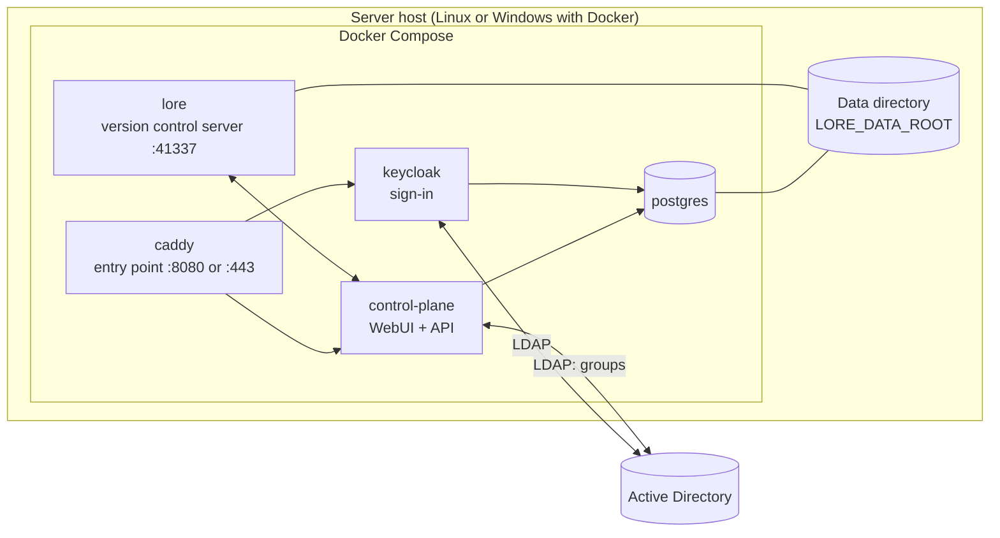

# Installing a Lore Platform server with Docker

This guide takes you from an empty machine to a running server that your team signs in to with
their Active Directory or email accounts, and then covers HTTPS, backups, upgrades and
troubleshooting. Everything runs in Docker Compose; the host only needs Docker.

For a compact reference of every script, argument, variable, port and directory, see
[docker.md](docker.md).

- [1. What gets installed](#1-what-gets-installed)
- [2. Requirements](#2-requirements)
- [3. Choose how people will reach the server](#3-choose-how-people-will-reach-the-server)
- [4. Install](#4-install)
- [5. Connect Active Directory](#5-connect-active-directory)
- [6. Email (optional)](#6-email-optional)
- [7. HTTPS](#7-https)
- [8. First steps after installing](#8-first-steps-after-installing)
- [9. Install the clients](#9-install-the-clients)
- [10. Backup and restore](#10-backup-and-restore)
- [11. Upgrade](#11-upgrade)
- [12. Settings reference](#12-settings-reference)
- [13. Troubleshooting](#13-troubleshooting)

## 1. What gets installed



| Container | Role | Stores data in |
|---|---|---|
| `caddy` | The only web entry point: WebUI, API and the sign-in pages. Terminates HTTPS when you enable it. Hides the Keycloak admin console. | `data/caddy` (certificates) |
| `control-plane` | WebUI and its API: repositories, permissions, users, audit log. Issues short-lived repository tokens to the Lore clients. | `data/control-plane` (token signing key) |
| `keycloak` | Sign-in: Active Directory accounts, local email accounts, optional self-registration, password reset mails. | PostgreSQL database `keycloak` |
| `postgres` | Databases `lore` (control plane) and `keycloak`. | `data/postgres` |
| `lore` | The Lore server: file contents, revisions, locks. Clients connect to it directly on port 41337. | `data/lore` |

Everything that matters lives in **one data directory** (`./data` next to the scripts, or wherever
`LORE_DATA_ROOT` points) plus the `.env` file with the generated secrets. Back up both.

## 2. Requirements

| | Minimum | Recommended for a team |
|---|---|---|
| CPU | 2 cores | 4 cores |
| Memory | 4 GB (Keycloak alone takes about 1 GB) | 8 GB |
| Disk | 10 GB + your repositories | SSD; repositories grow with every revision of every binary file |
| OS | Any Linux with Docker Engine 24+ and Compose v2, or Windows / macOS with Docker Desktop | Linux server |
| Network | see below | |

Ports opened on the host:

| Port | Used by | When |
|---|---|---|
| `8080/tcp` | WebUI, API, sign-in | HTTP mode and "behind your own reverse proxy" mode; another port with `LORE_HTTP_PORT` if 8080 is taken |
| `80/tcp`, `443/tcp`, `443/udp` | WebUI, API, sign-in over HTTPS | built-in HTTPS mode (`LORE_DIRECT_CADDY=true`) |
| `41337/tcp`, `41337/udp` | Lore clients (clone, sync, push, locks) | always |
| `41339/tcp` | Lore server health check | always; may be firewalled from users |

The server works **without internet access**. Only the installation itself needs to pull the
container images (or you can load them with `docker load` from another machine).

## 3. Choose how people will reach the server

Decide this before installing; you can change it later by running `setup` again.

| Mode | Address users type | Good for | You need |
|---|---|---|---|
| **HTTP (internal network)** | `http://lore.corp.local:8080` | Office network, quick start. No certificates. | A host name or IP that every client can reach. |
| **Built-in HTTPS** | `https://lore.example.com` | Server reachable from the internet. Certificates from Let's Encrypt, renewed automatically. | A public DNS name pointing to the host, ports 80 and 443 open. |
| **Behind your reverse proxy** | `https://lore.example.com` | You already run nginx, Traefik, IIS, a load balancer... | Your proxy terminates TLS and forwards to `http://host:8080`. |

In HTTP mode the Lore clients accept plain HTTP to the sign-in server **only when it is the same
host as the Lore server they connect to**, so nothing has to be configured on the clients.

> **The host name.** Without `LORE_PUBLIC_HOST` (`-PublicHost` on Windows) setup uses this
> computer's DNS name, for example `rndvm01` or `rndvm01.corp.local` in a domain — usually what
> clients on the internal network can reach. Set it when clients know the server under another
> name (an alias like `lore.corp.local`, or an IP). The name is saved in `.env`; to change it later
> run setup again with the new name — nothing else needs editing.
>
> Sign-in works only under this one name: Keycloak issues tokens and cookies for it. Opening the
> WebUI as `localhost`, by IP or under another name on port 8080 redirects to it. Don't use
> `localhost` as the name: inside the containers it means the container itself.
>
> **Only letters, digits, hyphens and dots.** A name with an underscore (`lore_server`,
> `mega_claude`) doesn't work: Keycloak, written in Java, can't parse such an address, so sign-in
> fails, and Let's Encrypt won't issue a certificate for it either — even though browsers open it.
> Rename the computer (`lore-server`), add a DNS alias without the underscore, or use the IP. If
> the computer's own name has an underscore and no name is given, setup uses its IP address.

## 4. Install

### 4.1 Get the server bundle

Download `lore-platform-server-<version>.tar.gz` (or `.zip`) from the
[Releases](../../../../releases/latest) page and unpack it where the server should live:

```sh
mkdir -p /opt && cd /opt
tar -xzf ~/lore-platform-server-0.3.0.tar.gz
cd lore-platform-server-0.3.0
```

The bundle contains only scripts and configuration; `setup` pulls the published images
`ghcr.io/arutar/lore-platform-control-plane` and `ghcr.io/arutar/lore-platform-server`.

<details>
<summary>Building the images from source instead</summary>

Clone the repository and run the same scripts from `platform/deploy`. Without
`LORE_CONTROL_PLANE_IMAGE` / `LORE_SERVER_IMAGE`, `setup` builds both images on the host. The
first build compiles the Rust server and takes 10–30 minutes and several GB of memory.

</details>

### 4.2 Put the data somewhere safe (recommended)

Keep data outside the unpacked bundle so upgrades are just "unpack the new version":

```sh
export LORE_DATA_ROOT=/srv/lore-data      # Windows: $env:LORE_DATA_ROOT = "D:\lore-data"
```

### 4.3 Run setup

**Linux, HTTP mode:**

```sh
LORE_PUBLIC_HOST=lore.corp.local sh setup.sh
```

**Windows (PowerShell, as the user that runs Docker Desktop):**

```powershell
$env:LORE_DATA_ROOT = "D:\lore-data"
.\setup.ps1 -PublicHost lore.corp.local
```

What `setup` does:

1. Creates `.env` with random passwords and secrets (only on the first run; later runs keep them).
2. Generates the Keycloak realm and the Lore server configuration for your address.
3. Starts all containers and waits until every health check passes.
4. Applies the settings to Keycloak (address, Active Directory, mail, client secret) and makes sure
   the local administrator account `admin` exists.
5. Puts the client downloads in place for the WebUI's home page (see below).
6. Prints the WebUI address and the **initial administrator password**.

```
Lore is ready.
WebUI: http://lore.corp.local:8080
Keycloak: http://lore.corp.local:8080/auth
Administrator: admin
Initial administrator password: 3f9c...
Data: /srv/lore-data
Client downloads: online
MCP: off
```

Open the WebUI and sign in as `admin` with that password. The password is also stored in `.env`
as `LORE_ADMIN_PASSWORD`.

`setup` is safe to run again at any time: it keeps the secrets and data, applies changed settings
and restarts what changed. Settings you pass once are saved to `.env`, so a plain `sh setup.sh`
later reuses them.

**Client downloads.** The WebUI's home page offers the client of the server's version for Windows
and Linux. By default (`online`) it links to the files of the release on GitHub. If your users
can't reach github.com, keep the files on the server instead (about 340 MB):

```sh
sh setup.sh --client-downloads offline
```

```powershell
.\setup.ps1 -ClientDownloads offline
```

Setup downloads them from the release, or takes them from a `clients/` folder next to it on a
host without internet access, and checks their SHA-256. See
[docker.md](docker.md#client-downloads).

**MCP for AI agents (optional).** AI agents such as Claude Code, Cursor or Hermes can read
repositories over MCP with a personal token. It's off unless you turn it on, for your internal
networks only or for everyone who can reach the WebUI:

```sh
sh setup.sh --mcp internal --mcp-networks "10.0.0.0/16;192.168.0.0/24"
sh setup.sh --mcp on
```

```powershell
.\setup.ps1 -Mcp internal -McpNetworks "10.0.0.0/16;192.168.0.0/24"
```

See [mcp.md](mcp.md) for tokens, who may use MCP and how to connect an agent.

### 4.4 Check

```sh
docker compose ps            # all services "healthy"
curl -fsS http://lore.corp.local:8080/healthz
```

Optional end-to-end self-test — **only on a test installation**, it runs backup and restore:

```sh
LORE_E2E=destroy-test-data bash test/e2e.sh                          # Linux
LORE_E2E=destroy-test-data LORE_E2E_POWERSHELL=true bash test/e2e.sh  # Windows, from Git Bash
```

## 5. Connect Active Directory

Pass the LDAP settings to `setup` (once; they are saved in `.env`):

```sh
LORE_LDAP_URL=ldaps://dc01.corp.local:636 \
LORE_LDAP_BASE_DN="DC=corp,DC=local" \
LORE_LDAP_BIND_DN="CN=svc-lore,OU=Service Accounts,DC=corp,DC=local" \
LORE_LDAP_BIND_PASSWORD='bind-password' \
sh setup.sh
```

```powershell
$env:LORE_LDAP_URL = "ldaps://dc01.corp.local:636"
$env:LORE_LDAP_BASE_DN = "DC=corp,DC=local"
$env:LORE_LDAP_BIND_DN = "CN=svc-lore,OU=Service Accounts,DC=corp,DC=local"
$env:LORE_LDAP_BIND_PASSWORD = "bind-password"
.\setup.ps1
```

- The bind account needs only read access to users and groups. Nothing is ever written to AD.
- Plain `ldap://...:389` works too; add `LORE_LDAP_STARTTLS=true` to encrypt it. For a domain
  controller with an internal CA that the containers don't trust, `LORE_LDAP_INSECURE_SKIP_VERIFY=true`
  skips certificate checks (prefer adding the CA instead).
- Users sign in with their Windows login name (`sAMAccountName`) and password.
- Accounts are identified by `objectGUID`, so renaming a user in AD keeps their access.
- Groups, including nested groups, can be given access to repositories. Changes in AD — removing
  someone from a group, disabling an account — take effect within `LORE_LDAP_REFRESH` (5 minutes),
  for the WebUI and for the Lore clients.
- If AD becomes unreachable, signed-in users keep their last known groups for
  `LORE_LDAP_OUTAGE_GRACE` (8 hours); after that group-based access is withheld until AD is back.
  Local accounts are not affected.
- The local `admin` always wins over an AD account with the same name.

A short host name (`ldap://dc01:389`) is resolved on the host during `setup` and passed into the
containers, so internal DNS names work even when Docker uses a different resolver.

## 6. Email (optional)

Without mail, administrators create local accounts with a temporary password and registration
stays closed. With mail, Keycloak can verify addresses, reset passwords and you can open
self-registration for external users in **Settings**.

```sh
LORE_SMTP_HOST=smtp.example.com LORE_SMTP_PORT=587 LORE_SMTP_STARTTLS=true \
LORE_SMTP_FROM=lore@example.com LORE_SMTP_USERNAME=lore@example.com LORE_SMTP_PASSWORD='...' \
sh setup.sh
```

For SMTPS on port 465 use `LORE_SMTP_PORT=465 LORE_SMTP_SSL=true LORE_SMTP_STARTTLS=false`.

## 7. HTTPS

### Built-in (Let's Encrypt)

```sh
LORE_PUBLIC_HOST=lore.example.com LORE_PUBLIC_SCHEME=https LORE_DIRECT_CADDY=true sh setup.sh
```

```powershell
.\setup.ps1 -PublicHost lore.example.com -Scheme https -DirectCaddy
```

Caddy listens on 80 and 443 and obtains and renews the certificate itself. The DNS name must
resolve to the host and ports 80/443 must be reachable from the internet. For names ending in
`.internal` or `localhost` Caddy uses its own local CA instead.

### Behind your reverse proxy

```sh
LORE_PUBLIC_HOST=lore.example.com LORE_PUBLIC_SCHEME=https LORE_PROXY_BIND=127.0.0.1 sh setup.sh
```

Forward `https://lore.example.com/*` to `http://127.0.0.1:8080` and pass the usual headers
(`Host`, `X-Forwarded-For`, `X-Forwarded-Proto: https`). `LORE_PROXY_BIND=127.0.0.1` keeps port 8080
closed to everyone except the proxy on the same host; leave it out if the proxy runs elsewhere.

Port 41337 for the Lore clients is not HTTP and does not go through the proxy; open it directly.

### Sign-in on a separate domain

`LORE_AUTH_PUBLIC_URL=https://login.example.com` serves Keycloak on its own name (Caddy gets a
certificate for it too). Most installations don't need this.

## 8. First steps after installing

1. Sign in as `admin`. Change the password on the account page
   `<WebUI address>/auth/realms/lore/account` → *Signing in*, or keep the generated one in your
   password manager.
2. **Settings** — interface language and theme for everyone, registration on/off.
3. **Users** — add people from Active Directory (search by name) or create local accounts for
   external partners (email + temporary password).
4. **New repository** — name it like `team/project`; it is private by default.
5. Repository → **Access** — give *Read*, *Write* or *Owner* to users and AD groups, or switch on
   "all signed-in users" / "public".
6. Copy the repository address (`lore://...`) with the copy button and send it to the team.
7. **MCP** (when it's on) — people create their own tokens for AI agents in the left menu; in
   **Users and groups** the MCP switch turns it off for a person or a group. See [mcp.md](mcp.md).

## 9. Install the clients

The WebUI's home page offers the client of the server's version, with a copyable `curl` command for
Linux. The same files are on the [Releases](../../../../releases/latest) page:

- **Windows:** `LoreClient-<version>-x64.msi`. Installs the `lore` CLI, the Explorer integration
  (context menu, status icons) and the sign-in companion. Requires the Microsoft Edge WebView2
  Runtime, which current Windows 10/11 already have.
- **Linux:** `lore-cli-<version>-<arch>.tar.gz`:

  ```sh
  tar -xzf lore-cli-0.3.0-x86_64-unknown-linux-gnu.tar.gz
  install -m 0755 lore ~/.local/bin/lore
  ```

Working with a repository:

```sh
lore clone lore://lore.corp.local:41337/team/project project   # opens the browser to sign in once
cd project
lore stage hello.txt
lore commit "Add hello"
lore push
lore sync                                                      # get other people's changes
```

On Windows the same is available from the Explorer context menu: **Lore Clone...**, **Lore Sync**,
**Lore Commit...**, **Acquire locks**, **History**.

The client signs in once per server through the browser and keeps the session. Signing in with
a different account on the same server replaces the previous one.

**Themes on Windows.** The Explorer context menu and the status icons follow Windows' own light or
dark mode. The Lore windows (Clone, Commit, Sync, Accounts...) have the same nine themes as the
WebUI, Midnight by default: right-click in Explorer → **Lore** → **Accounts** and choose **Window theme**.
The choice is per Windows user and is stored in `%LOCALAPPDATA%\Lore\client.json` (`"Theme"`).

## 10. Backup and restore

```sh
sh backup.sh                      # → ./backups/<date-time>/
sh backup.sh /mnt/backup nightly  # custom destination and name
```

```powershell
.\backup.ps1
.\backup.ps1 -Destination E:\backup -Name nightly
```

A backup contains both databases, all repository contents, the token signing key and `.env`. The
services are stopped for the duration (usually seconds to minutes) and started again. The backup
directory is readable only by its owner — it contains secrets. Copy it off the host.

Restore (replaces the current state; makes a safety copy of the current databases first and rolls
back if anything fails):

```sh
sh restore.sh backups/20261113-020000 --yes
```

```powershell
.\restore.ps1 -Backup backups\20261113-020000
```

Schedule backups with cron or Task Scheduler, for example nightly at 02:00:

```cron
0 2 * * * cd /opt/lore-platform-server-0.3.0 && sh backup.sh /mnt/backup >> /var/log/lore-backup.log 2>&1
```

## 11. Upgrade

1. `sh backup.sh`
2. Unpack the new bundle next to the old one.
3. Copy `.env` from the old directory to the new one. If your data is in `./data` (no
   `LORE_DATA_ROOT`), stop the old installation (`docker compose down`) and move `data/` too.
4. In the new directory: `sh setup.sh` (or `.\setup.ps1`).

Database migrations run automatically when the control plane starts.

## 12. Settings reference

All settings can be passed as environment variables to `setup`; they are saved in `.env`. The
complete list, with the parameters of every script, is in [docker.md](docker.md#settings-environment-variables-and-env).

| Variable | Default | Meaning |
|---|---|---|
| `LORE_PUBLIC_HOST` | this computer's DNS name (its IP if the name isn't a valid host name) | Name (or IP) clients use to reach the server: letters, digits, `-` and `.` only, **no `_`**. Saved in `.env`; run setup with a new value to change it |
| `LORE_PUBLIC_SCHEME` | `http` | `http` or `https` |
| `LORE_HTTP_PORT` | `8080` | WebUI port in `http` mode, when 8080 is taken on the host |
| `LORE_PUBLIC_URL` | `http://HOST:8080` or `https://HOST` | Full WebUI address, if it differs from the default |
| `LORE_AUTH_PUBLIC_URL` | `<public URL>/auth` | Sign-in (Keycloak) address |
| `LORE_DIRECT_CADDY` | `false` | `true`: Caddy listens on 80/443 and manages certificates |
| `LORE_PROXY_BIND` | `0.0.0.0` | Interface for port 8080; `127.0.0.1` behind a local reverse proxy |
| `LORE_DATA_ROOT` | `./data` | Where all data is stored |
| `LORE_CLIENT_DOWNLOADS` | `online` | Client downloads on the home page: `online` (links to GitHub), `offline` (files kept on the server) or `off` |
| `LORE_MCP` | `off` | MCP for AI agents: `off`, `internal` (only `LORE_MCP_NETWORKS`) or `on`; see [mcp.md](mcp.md) |
| `LORE_MCP_NETWORKS` | — | Networks for `internal`, e.g. `10.0.0.0/16;192.168.0.0/24` |
| `LORE_MCP_CONCURRENCY` | `8` | MCP calls one token may run at once; `0`: no limit |
| `LORE_MCP_MAX_READ` | `1048576` | Most bytes of text one `read_text` call returns |
| `LORE_MCP_LINK_TTL` | `10m` | How long an MCP download link works |
| `LORE_LDAP_URL` | — | `ldap://` or `ldaps://` URL of a domain controller; enables AD |
| `LORE_LDAP_BASE_DN` | — | Where users and groups are searched |
| `LORE_LDAP_BIND_DN`, `LORE_LDAP_BIND_PASSWORD` | — | Read-only service account |
| `LORE_LDAP_STARTTLS` | `false` | Upgrade `ldap://` to TLS |
| `LORE_LDAP_INSECURE_SKIP_VERIFY` | `false` | Don't verify the DC certificate |
| `LORE_LDAP_USERNAME_ATTRIBUTE` | `sAMAccountName` | Login attribute |
| `LORE_LDAP_TIMEOUT` | `60s` | LDAP request timeout (1s–1m) |
| `LORE_LDAP_REFRESH` | `5m` | How often groups and account status are re-read |
| `LORE_LDAP_OUTAGE_GRACE` | `8h` | How long last known groups are trusted while AD is down |
| `LORE_SMTP_HOST`, `LORE_SMTP_PORT` | —, `587` | Mail server |
| `LORE_SMTP_FROM`, `LORE_SMTP_FROM_NAME` | —, `Lore` | Sender |
| `LORE_SMTP_USERNAME`, `LORE_SMTP_PASSWORD` | — | Mail account |
| `LORE_SMTP_STARTTLS`, `LORE_SMTP_SSL` | `true`, `false` | Mail encryption |
| `LORE_CONTROL_PLANE_IMAGE`, `LORE_SERVER_IMAGE` | bundle version | Use other images (e.g. a mirror) |

Generated by `setup`, keep them secret: `POSTGRES_PASSWORD`, `KEYCLOAK_ADMIN_PASSWORD`,
`LORE_ADMIN_PASSWORD` (initial `admin` password), `LORE_SERVICE_CLIENT_SECRET`.

## 13. Troubleshooting

| Symptom | Check |
|---|---|
| `setup` stops at "waiting for ... healthy" | `docker compose logs --tail 100 <service>`. Keycloak needs about a minute and 1 GB of RAM on the first start. |
| Sign-in redirects to a name clients can't reach (for example `host.docker.internal` from an older install) | Run `setup` again with `LORE_PUBLIC_HOST` (`-PublicHost`) set to the name clients use. |
| The WebUI opens but sign-in fails ("Invalid redirect uri", errors from Keycloak), and the host name has an `_` | Underscores aren't valid in host names and Keycloak rejects them. Rename the computer or use a DNS alias without `_` (or the IP), then run `setup` again with it. |
| AD users can't sign in, local accounts can | `docker compose logs keycloak | grep -i ldap`. Check the bind account, the base DN and that the DC is reachable from the host (`setup` resolves short names on the host). |
| Someone removed from an AD group still has access | Access follows AD within `LORE_LDAP_REFRESH` (5 min by default). |
| Clients can't clone, the WebUI works | Port 41337 (TCP **and** UDP) must be open between clients and the host. |
| On the host itself, the WebUI or a Lore client takes 20–40 s to connect by the host's name; other computers are fast | Windows resolves its own name to every adapter's address, Hyper-V and WSL adapters included, and connections to those are dropped by the firewall until they time out. Use `localhost` or the IP on the host, or allow the WebUI port and 41337 on the `vEthernet` adapters. |
| Windows Explorer shows no Lore status icons | Windows has a limited number of overlay icon slots; OneDrive, Dropbox or TortoiseSVN may take them all. |
| Forgot the `admin` password | Another administrator can't reset it from the WebUI; reset it in Keycloak from the host: `docker compose exec keycloak bash -c '/opt/keycloak/bin/kcadm.sh config credentials --server http://127.0.0.1:8080/auth --realm master --user admin --password "$KC_BOOTSTRAP_ADMIN_PASSWORD" && /opt/keycloak/bin/kcadm.sh set-password -r lore --username admin --new-password "NEW-PASSWORD"'`. If the `admin` account was deleted, `setup` recreates it with `LORE_ADMIN_PASSWORD` from `.env`. |

Logs of everything: `docker compose logs -f`. Container status: `docker compose ps`.
